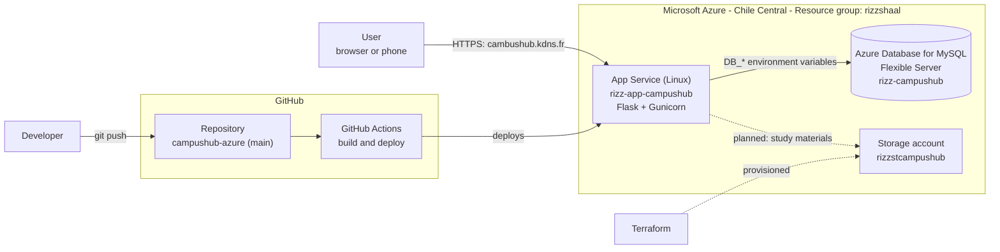

<div align="center">

# 🎓 CampusHub

**One portal for students, teachers and administrators**

Built with Flask and MySQL · Hosted on Microsoft Azure · Deployed automatically with GitHub Actions

### 🌐 [Live demo: cambushub.kdns.fr](https://cambushub.kdns.fr)

*The demo may be taken offline from time to time to save cloud cost.*

</div>

---

## 📖 About

CampusHub is a college portal with a separate area for **students**, **teachers** and **administrators**. It handles notices, attendance, courses and subjects, and study materials.

I built it as a **cloud learning project**: write the app, then take it all the way to a live, secure, automatically deployed site on Microsoft Azure.

---

## ✨ Features

| Role | What they can do |
|---|---|
| 👩‍🎓 **Student** | Register and sign in, view overview, attendance, notices and study materials |
| 👨‍🏫 **Teacher** | Mark attendance, view assigned subjects |
| 🛠️ **Admin** | Create teacher accounts, view student and faculty directories, create courses, add subjects and assign teachers, publish notices, upload PDF study materials |

---

## 🏗️ Architecture



### How it works

**1. A user visits the site**
The domain `cambushub.kdns.fr` points to Azure App Service through DNS. An App Service managed certificate gives HTTPS. Gunicorn runs the Flask app, which reads and writes data in MySQL.

**2. A developer ships a change**
I push code to `main` on GitHub. GitHub Actions builds the app and deploys it to App Service. The new version is live in about a minute.

**3. The app finds its database**
The app never stores passwords in code. It reads the database host, port, user, password and name from **App Service environment variables**.

### Components

| Component | Name | Purpose |
|---|---|---|
| Resource group | `rizzshaal` | Holds every Azure resource for the project |
| Web hosting | App Service on Linux, `rizz-app-campushub` | Runs the Flask app |
| Database | Azure Database for MySQL Flexible Server, `rizz-campushub` | Stores users, notices, attendance, courses and subjects |
| Storage | Storage account, `rizzstcampushub` | Created with Terraform. Planned home for study material files |
| CI/CD | GitHub Actions | Builds and deploys on every push to `main` |
| Infrastructure as Code | Terraform | Resource group and storage account |
| Domain | `cambushub.kdns.fr` | Custom domain with DNS A and TXT records |
| HTTPS | App Service Managed Certificate (SNI SSL) | Free, auto-renewing certificate |

---

## 🛠️ Technology

| Layer | Tools |
|---|---|
| Backend | Python, Flask, Gunicorn |
| Frontend | HTML, CSS, JavaScript (Jinja templates) |
| Database | MySQL 8.4 |
| Cloud | Azure App Service, Azure Database for MySQL, Storage Account |
| DevOps | GitHub Actions, Terraform |

---

## 📁 Project structure

```
CampusHub/
├── .github/workflows/   # GitHub Actions deployment workflow
├── app/
│   ├── app.py           # Flask application
│   ├── static/          # CSS and static files
│   ├── templates/       # HTML pages for each role
│   └── uploads/         # Uploaded study materials
├── terraform/           # Terraform files for Azure resources
├── database.py          # MySQL connection (reads environment variables)
├── requirements.txt     # Python packages
└── README.md
```

---

## 🚀 Run it locally

**1. Clone the repository**

```powershell
git clone https://github.com/rizzshaal/campushub-azure.git
cd campushub-azure
```

**2. Create and activate a virtual environment**

```powershell
py -m venv venv
.\venv\Scripts\Activate.ps1
```

**3. Install the packages**

```powershell
pip install -r requirements.txt
```

**4. Set the database connection values** (use your own MySQL details, never commit them)

```powershell
$env:DB_HOST = "your-mysql-server-host"
$env:DB_PORT = "3306"
$env:DB_USER = "your-mysql-username"
$env:DB_PASSWORD = "your-mysql-password"
$env:DB_NAME = "your-database-name"
```

**5. Start the app**

```powershell
python app\app.py
```

**6. Open** http://127.0.0.1:5000

---

## ☁️ Azure deployment

**App Service settings** (Settings → Environment variables)

| Setting | Meaning |
|---|---|
| `DB_HOST` | MySQL server address |
| `DB_PORT` | MySQL port (3306) |
| `DB_USER` | Database username |
| `DB_PASSWORD` | Database password |
| `DB_NAME` | Database name |

**Startup command**

```bash
gunicorn --bind=0.0.0.0 --timeout 600 --chdir app app:app
```

**CI/CD:** the workflow "Build and deploy Python app to Azure Web App" was created from Deployment Center and runs on every push to `main`.

**Custom domain:** `cambushub.kdns.fr` was added in App Service → Custom domains with an **A record** and a **TXT (`asuid`) record** at the DNS provider, then secured with a free managed certificate.

---

## 🔒 Security

- Database credentials live in **App Service environment variables**, not in the repository
- **HTTPS** on the custom domain
- FTP set to FTPS only, and basic-auth publishing credentials disabled
- Demos use **dummy accounts and sample data** only

---

## 🧠 What I learned

- Hosting a Flask and MySQL app on Azure App Service and wiring it to a managed database
- Setting up CI/CD with GitHub Actions
- Writing starter infrastructure as code with Terraform
- Custom domains: DNS records, domain validation and HTTPS certificates
- Troubleshooting: a browser "Dangerous site" warning on a new site, and DNS validation errors

---

## 🗺️ Roadmap

- [x] Flask + MySQL app with student, teacher and admin areas
- [x] Deployed to Azure App Service with a managed MySQL database
- [x] Automatic deployment with GitHub Actions
- [x] Custom domain with HTTPS
- [ ] Teacher marks and results entry
- [ ] Store study materials in Azure Blob Storage
- [ ] Azure Key Vault and Managed Identity for secrets
- [ ] Automated tests and security scanning in the pipeline
- [ ] Move all infrastructure into Terraform
- [ ] Monitoring, backups and cost alerts

---

<div align="center">

**Muhammed Rishal K (Rizzshaal)**
B.Sc. Computer Science student · Aspiring Cloud / DevOps Engineer

[GitHub](https://github.com/rizzshaal) · [Live demo](https://cambushub.kdns.fr)

</div>